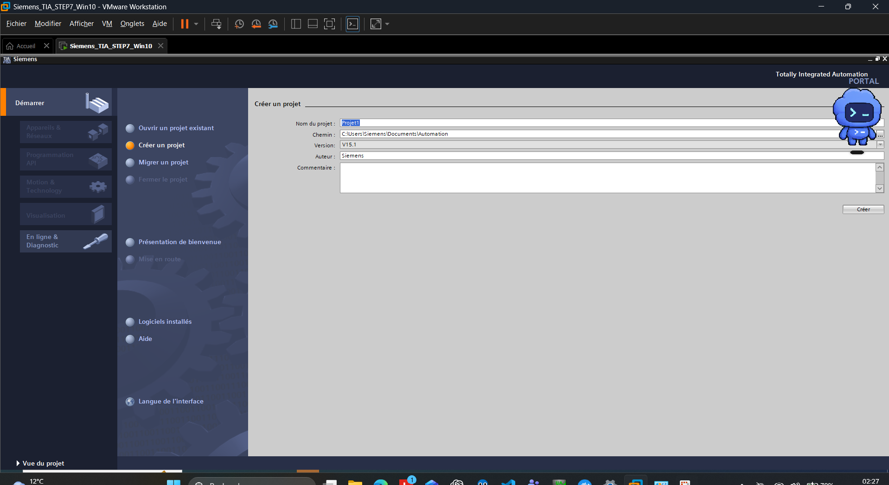

# Siemens TIA Portal — Laboratoire d'automatisme industriel

📄 **[Consulter la documentation technique complète (PDF)](Documentation_TIA_Portal.pdf)**

**Installation, configuration et validation d'un environnement d'ingénierie Siemens virtualisé sous VMware Workstation.**

Ce projet s'inscrit dans la création d'un laboratoire personnel **OT/IT (Operational Technology / Information Technology)** destiné à expérimenter l'automatisme industriel, la supervision SCADA et l'administration des systèmes industriels.

## 1. Présentation du projet

L'objectif est de disposer d'une machine virtuelle Windows indépendante du système hôte, dédiée aux outils d'ingénierie Siemens.

Cet environnement permet notamment de :

- Installer et configurer les logiciels Siemens.
- Préparer des projets d'automatisation PLC et HMI.
- Étudier les outils STEP 7 et WinCC.
- Expérimenter les communications industrielles.
- Intégrer ultérieurement le poste dans une infrastructure OT/IT centralisée.

## 2. Environnement technique

| Composant | Technologie / Version |
|---|---|
| Machine hôte | Lenovo LOQ |
| Virtualisation | VMware Workstation |
| Système invité | Windows 10 Pro 22H2 |
| TIA Portal | V15.1 Update 5 |
| STEP 7 Professional | V15.1 Update 5 |
| WinCC Professional | V15.1 Update 5 |
| WinCC Runtime Advanced | V15.1 Update 5 |
| STEP 7 Classic | V5.7 SP2 — validation de licence à confirmer |
| Automation License Manager | V6.0 SP8 |
| VMware Tools | 13.1.5 |

Les versions proviennent des captures et des composants identifiés lors des installations.

## 3. Installation et configuration

Les travaux documentés comprennent :

**Virtualisation et Windows**
- Préparation de la machine virtuelle sous VMware.
- Installation de Windows 10 Professionnel.
- Vérification de la version du système.
- Installation et utilisation de VMware Tools.

**Environnement Siemens**
- Téléchargement des composants TIA Portal.
- Configuration de l'installation STEP 7 Professional et WinCC Professional.
- Vérification des composants Siemens et Microsoft installés.
- Ouverture de TIA Portal V15.1.
- Lancement de l'installation STEP 7 Classic V5.7 SP2.
- Identification des éléments de licence à contrôler.

**Diagnostic**
- Gestion du redémarrage demandé par l'installateur Siemens.
- Vérification des programmes et services installés.
- Contrôle de l'ouverture de l'environnement TIA Portal.

## 4. Captures et validation

Les captures du dossier `images/` documentent les principales étapes d'installation et de configuration.

**Résultats confirmés :** Windows 10 démarre, TIA Portal V15.1 s'ouvre et les composants Siemens documentés sont présents dans l'environnement.

**Points restant à vérifier :** validation fonctionnelle complète des logiciels, ressources matérielles exactes de la VM et état final de la licence STEP 7 Classic.

## 5. Documentation complète

La documentation technique est rédigée en **LaTeX** et contient les explications, procédures, captures d'écran et incidents rencontrés.

Structure du dépôt :

- `main.tex` — Documentation technique principale.
- `images/` — Captures d'écran de l'environnement Siemens.
- `README.md` — Présentation du projet.

### Compilation avec Overleaf

1. Télécharger le dépôt GitHub au format ZIP.
2. Importer l'archive dans [Overleaf](https://www.overleaf.com/).
3. Sélectionner `main.tex` comme fichier principal.
4. Compiler avec `pdfLaTeX`.

## 6. Intégration dans le laboratoire OT/IT

Cette VM Siemens est également utilisée dans un laboratoire réseau comprenant un contrôleur de domaine Windows Server 2022, DNS, Active Directory, des comptes utilisateurs et des stratégies de groupe (GPO).

La configuration réseau et l'intégration au domaine `ad.lab` sont documentées dans le projet complémentaire :

[**Windows Server & Active Directory — Laboratoire OT/IT**](https://github.com/daousekou/Windows-Server-Active-Directory-Lab)

## 7. Évolutions prévues

- Approfondissement des essais STEP 7 et WinCC.
- Simulations d'automates et communications industrielles.
- Intégration avec des solutions SCADA.
- Développement d'une infrastructure de supervision avec Ignition et AVEVA.
- Extension de l'environnement de test OT/IT.

Ces évolutions ne sont pas présentées comme déjà réalisées.

---

**Auteur :** Sekou DAOU

**Domaine :** Automatisme industriel • SCADA • Virtualisation • Informatique industrielle

*Projet personnel à vocation pédagogique. Les logiciels Siemens sont soumis à leurs conditions de licence. Aucun mot de passe ni clé de licence n'a été publié dans ce dépôt.*
